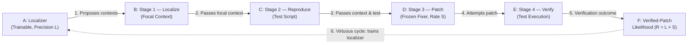

# Decompose, Then Decide

**A Fixer-Guided Harness for Reliable Offline Code Repair with Gemma 4 E4B**

[](main.pdf)
[](https://www.kaggle.com/competitions/gemma-4-developer-agent)

> **Status:** Research proposal with a falsifiable protocol. Not a completed implementation. The central mechanism (the "virtuous cycle") is unvalidated — this repo exists to make the validation reproducible.

---

## The problem

Reliable coding agents today depend on large cloud models and reinforcement learning infrastructure that individual developers cannot run. Small open models like Gemma 4 E4B can write code, but in a free-form agent loop they fail at repository-level repair — not because their code generation is weak, but because exploration, context management, and patch decisions all compete for the same limited capacity. The result is a **14.6% resolve rate**.

## Two isolated breakthroughs

| Work | What it does | Result |
| --- | --- | --- |
| **Harness decomposition** | Structures repair into four explicit stages: localize → reproduce → patch → verify | 14.6% → **45.7%** |
| **Fixer-Guided Localization (FGL)** | Trains the localizer against the downstream fixer's verified-patch likelihood, not human relevance labels | fixer finds bugs as often as a teacher, using **27.5% less code** |

Neither has been combined. FGL has only ever been trained inside a free-form loop. Harness decomposition has only ever been used at inference time — never as a training signal.

## The proposal

Treat the harness itself as a **training signal**. Train the localizer *inside* the decomposed four-stage harness, using the frozen fixer's verified-patch likelihood as the reward.

Stage separation gives the localizer exactly one downstream consumer, and that consumer already emits a binary, machine-checkable signal — whether the patch passed its test. Training against that signal inside a clean harness should produce a **virtuous cycle**: a cleaner harness → a denser fixer signal → a more precise localizer → better focal contexts → back to the fixer.



## Formalization

The resolve rate decomposes into two independently measurable factors:

$$
R = L \times S
$$

where:

- $L = P(\text{fix site} \in \text{focal context})$ — **localizer precision** (reach)
- $S = P(\text{verified patch} \mid \text{fix site} \in \text{focal context})$ — **conditional fixer success** (conversion given reach)

Both factors are estimated directly from SWE-bench gold patches and a single evaluation run. A localizer that returns the whole repository achieves $L = 1$ but collapses $S$; a localizer that returns one arbitrary function maximizes neither.

To separate **synergy** from a merely **additive** result, we define an analytical additive baseline:

$$
B5 = \sigma\!\left(\operatorname{logit}(B2) + \operatorname{logit}(B3) - \operatorname{logit}(B1)\right)
$$

and require $B4 - B5 > \delta$ (95th percentile of a bootstrap over five seeds) before claiming the cycle is operating.

## Hypotheses

| ID | Claim | Falsified if |
| --- | --- | --- |
| **H1** (effectiveness) | The unified method matches or beats the decomposed-harness baseline while using less code context than FGL in a free-form loop | $B4 < 45.7\%$, or B4 uses ≥ B3's code tokens per task |
| **H2a** (training-time synergy) | Training the localizer inside the harness yields a more precise localizer than training in free-form | $L(B4) \le L(B3)$ |
| **H2b** (inference-time synergy) | Better focal contexts raise conditional fixer success above the untrained-harness level | $S(B4) \le S(B2)$ |

The virtuous-cycle claim requires **both** H2a and H2b. If H2b holds but H2a does not, the gain is deployment-only and would be obtained by plugging existing FGL adapters into the harness without retraining — which would reduce the contribution from a training method to a deployment recipe.

## Protocol

All experiments run on a **single consumer GPU**, with **no reinforcement learning infrastructure** and **no cloud APIs**.

Before committing training compute, a zero-training **10-task pilot** on the [competition development set](https://www.kaggle.com/competitions/gemma-4-developer-agent/data) gates the full run:

1. B2 must reproduce within ±5 points of 45.7%
2. The localizer must produce ≥ 2 distinct focal contexts on ≥ 80% of pilot tasks
3. The median number of candidate contexts containing the fix site must be ≥ 1

An **oracle-context ceiling run** — using the gold-patch functions as the focal context — measures $S_{\max}$, so the maximum achievable $R = L \times S_{\max}$ is known before results are interpreted.

## What this repo does and does not claim

This is a **proposed framework with a falsifiable protocol**, not a completed implementation.

- The virtuous cycle is unvalidated.
- FGL's absolute gains in standalone testing are modest (8 vs. 6 tasks solved on its development set).
- The headroom inside a harness that already reaches 45.7% may be smaller than the free-form setting suggests.

Both limitations are stated explicitly in the paper, along with the exact conditions under which each hypothesis fails.

## Repository contents

| Path | What it is |
| --- | --- |
| `main.pdf` | The full paper (3,150 words) |
| `main.tex` | LaTeX source, single file, no external dependencies beyond standard packages |
| `figures/figure1.png` | The framework diagram (also embedded in the paper) |

Compile with:

```bash
pdflatex main.tex
pdflatex main.tex   # twice, for references
```

## Citation

```bibtex
@misc{jain2026decompose,
  title  = {Decompose, Then Decide: A Fixer-Guided Harness for Reliable Offline Code Repair with Gemma 4 E4B},
  author = {Jain, Naman},
  year   = {2026},
  note   = {Submission to the Gemma 4 Developer Agent Competition, Paper Track},
  url    = {https://github.com/NamanJain1902/decompose-then-decide}
}
```

## References

1. Dente, F., Satriani, D., Santoro, D., Veltri, E., & Papotti, P. (2026). *Who Should Own the Loop? Harness Decomposition for Small-Model Repository Repair.* AgenticDev Workshop at ASE. [doi:10.1145/3843282.3844442](https://doi.org/10.1145/3843282.3844442)
2. Hennara, K., Hreden, M., Aldallal, Z., et al. (2026). *Let the Fixer Decide: Training a Code Localizer from the Fixer's Likelihood.* [arXiv:2611.12164](https://arxiv.org/abs/2611.12164)
3. Pokhrel, K. (2026). *How I Built TOPAZ: Competing in Google's Gemma 4 Paper Track.* Author technical report (Medium; not peer-reviewed).
4. Google. (2026). *The Gemma 4 Developer Agent Competition.* [Kaggle](https://www.kaggle.com/competitions/gemma-4-developer-agent/data)
5. Jimenez, C. E., et al. (2024). *SWE-bench: Can Language Models Resolve Real-world GitHub Issues?* ICLR.
6. Jimenez, C. E., et al. (2024). *SWE-bench Lite.* [github.com/swe-bench/SWE-bench](https://github.com/swe-bench/SWE-bench)